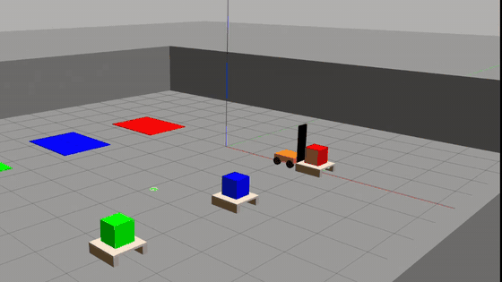
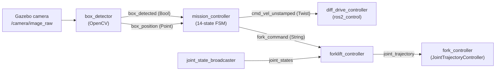
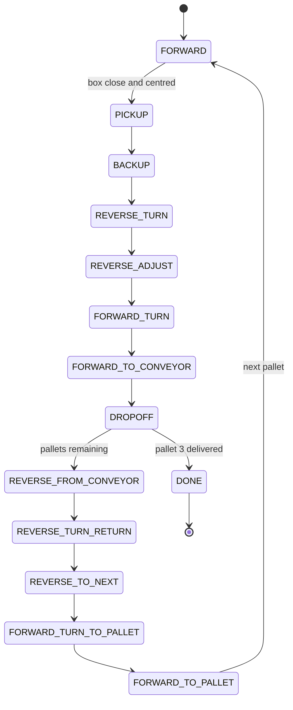

# Autonomous Guided Sorting Vehicle (AGSV)

A simulated autonomous forklift built with **ROS 2 Humble** and **Gazebo**. It uses a single onboard camera to find colour-coded boxes on pallets, steers itself onto each pallet, lifts it, and carries it to the matching drop-off zone. A 14-state mission controller runs the whole job, all three pallets, with no human input.

<p align="center">
  
</p>

## Demo

Full three-pallet run (shown at 3× speed, about 1 minute):

<!-- DEMO_VIDEO: edit this README on github.com, delete this comment, and drag AGSV_demo.mp4 onto this spot.
     GitHub uploads it and inserts a https://github.com/user-attachments/assets/... link on its own line,
     which shows as an inline video player. -->

📊 **[Project presentation (PDF)](docs/AGSV_slides.pdf)**

---

## Table of Contents
- [Demo](#demo)
- [What it does](#what-it-does)
- [Design decisions](#design-decisions)
- [System architecture](#system-architecture)
- [Mission state machine](#mission-state-machine)
- [Perception pipeline](#perception-pipeline)
- [Robot and world model](#robot-and-world-model)
- [Getting started](#getting-started)
- [ROS 2 interface](#ros-2-interface)
- [Project structure](#project-structure)
- [Challenges](#challenges)
- [Limitations and future work](#limitations-and-future-work)
- [Team](#team)

---

## What it does

The warehouse world has **three pallets** in a row. Each pallet has a coloured box on it (red, blue, green), and each has a colour-matched drop zone across the aisle. For each pallet, the robot:

1. **Searches and approaches.** It drives forward until the camera picks up a coloured box, then steers toward it with proportional visual servoing.
2. **Aligns and picks up.** Once the box is close and centred in the image, it stops, lowers the forks, creeps forward to slide them under the pallet, and raises the load to 0.5 m.
3. **Turns around.** It backs out and does a two-part three-point turn (a 90° reverse arc, then a 90° forward arc) so it ends up facing the drop zones.
4. **Drops off.** It drives to the drop zone, lowers the forks, and backs away from the pallet (a "dip and retreat" so the load isn't dragged).
5. **Moves to the next pallet.** It reverses down the aisle to the next pallet's row, turns to face it, and starts searching again.

After the third drop-off, the controller goes to `DONE` and stops the robot.

---

## Design decisions

| Area | Choice | Why |
|---|---|---|
| Navigation | A **hybrid state machine**: visual servoing for the approach, timed dead reckoning for the fixed moves after pickup, **instead of Nav2** | The warehouse layout is known and fixed, and the hard part is the final approach to the pallet, which the camera handles. A full Nav2 stack (map, localization, planner) would add a lot of setup for little gain in a three-pallet world. |
| Perception | **HSV colour thresholding** with contour moments | The boxes are solid primary colours, so classic segmentation is fast, needs no training data, and is easy to debug from the annotated image. |
| Manipulation | A **simplified prismatic lift** with high-friction forks | Gazebo's contact physics are fragile for real fork-under-pallet grasping. A stiff, single-joint lift keeps the pallet stable enough to test the full mission. |
| Control | **`ros2_control`** with a diff-drive controller and a joint-trajectory fork controller | Uses standard controllers instead of hand-written wheel and joint logic, so the custom nodes only send velocities and fork targets. |

The mission controller went through three versions:

1. A simple lift sequence.
2. A full pickup-to-delivery cycle using timed maneuvers.
3. Tuned dead reckoning, plus the "dip and retreat" unloading move for a stable drop-off.

---

## System architecture

Three custom nodes share the work. Perception, mission logic and actuator control are kept separate, so each can be tested or replaced on its own.



| Node | Role |
|---|---|
| `box_detector` | Turns each camera frame into a detection flag plus the box's normalized image position and an estimated range. |
| `mission_controller` | Runs the state machine at 10 Hz and publishes drive (`Twist`) and fork (`raise`/`lower`) commands. |
| `forklift_controller` | Turns the high-level fork commands into joint trajectories for the `ros2_control` fork controller, and logs lift progress. |

The launch file starts Gazebo and spawns the robot. Once the spawn process exits, it starts the `ros2_control` controllers, then starts the custom nodes after a short delay so the simulation is ready first.

---

## Mission state machine

`mission_controller` is a **14-state finite state machine**. Approach and alignment respond to the camera. The maneuvers after pickup are timed velocity commands.



| Phase | States | What happens |
|---|---|---|
| Approach | `FORWARD` | Cruises at 0.3 m/s with light steering (gain 1.5) toward any detected box. When the range estimate falls under the close-range threshold, it slows to 0.15 m/s and steers harder (gain 2.0) until the box is centred within ±0.15 of the image centre. |
| Pickup | `PICKUP` | Lowers the forks, creeps forward to slide them in, stops, and raises the forks to 0.5 m. |
| Turnaround | `BACKUP` → `REVERSE_TURN` → `REVERSE_ADJUST` → `FORWARD_TURN` | Backs out, then does a reverse arc and a forward arc that together turn the robot 180° to face the conveyors. |
| Delivery | `FORWARD_TO_CONVEYOR` → `DROPOFF` | Drives to the drop zone, lowers the load, and backs away from it. |
| Reposition | `REVERSE_FROM_CONVEYOR` → `REVERSE_TURN_RETURN` → `REVERSE_TO_NEXT` → `FORWARD_TURN_TO_PALLET` → `FORWARD_TO_PALLET` | Retraces the path and backs down the aisle to the next pallet row, faces it, and goes back to `FORWARD`. |
| Finish | `DONE` | After pallet 3, publishes a zero velocity and holds still. |

---

## Perception pipeline

`box_detector` uses classic computer vision only, with no learned model:

1. **Convert** each 640×480 frame from BGR to **HSV**. Hue separates colours more reliably than RGB when lighting changes.
2. **Threshold** red (two hue bands, because red wraps around 0°/180°), blue and green, and combine them into one mask.
3. **Clean up** the mask with a morphological close followed by an open (5×5 kernel) to fill holes and remove speckle.
4. **Pick the largest external contour** and ignore anything under `min_area` (500 px²).
5. **Compute the centroid** from image moments (`m10/m00`, `m01/m00`) and normalize it to [-1, 1], where 0 is the image centre.
6. **Estimate range** from apparent size: `5000 / √area`. A bigger blob means a closer box.

Every frame publishes a `box_detected` flag. Frames with a valid detection also publish `box_position`, where x and y are the normalized centroid and z is the range estimate. Set `debug_view: true` to also publish an annotated image on `/detection_debug`, with the contour, centroid, area and estimated distance drawn on.

---

## Robot and world model

**Robot** (`urdf/robot.urdf.xacro`)
- Four-wheel chassis driven as a **differential drive**: the front wheels are powered, the rear wheels are passive. Wheel radius 0.1 m, track 0.5 m.
- Mast with a **prismatic fork-lift joint** (range −0.12 to 0.5 m), driven by a `JointTrajectoryController` with high-stiffness PID gains so it can lift a loaded pallet without sagging.
- Forward-facing **camera**: 640×480, 30 Hz, about 80° horizontal field of view.
- Controlled through `ros2_control` with the `gazebo_ros2_control` plugin, with the controller manager running at 100 Hz.

**World** (`worlds/warehouse.world`)
- Three wooden pallets (deck on two stringers) 3 m apart, each carrying a 0.4 m red, blue or green box.
- Three colour-matched drop zones (`conveyor_belt`, `conveyor_belt2`, `conveyor_belt3`) across the aisle.
- Walls closing off the warehouse floor.

---

## Getting started

### Prerequisites
- Ubuntu **22.04** (Jammy) with ROS 2 **Humble**
- Gazebo Classic with `gazebo_ros_pkgs`
- `ros2_control`, `ros2_controllers`, `gazebo_ros2_control`, `xacro`, `cv_bridge`

```bash
sudo apt install ros-humble-gazebo-ros-pkgs ros-humble-ros2-control \
  ros-humble-ros2-controllers ros-humble-gazebo-ros2-control \
  ros-humble-xacro ros-humble-cv-bridge
```

### Build

```bash
mkdir -p ~/ros2_ws/src && cd ~/ros2_ws/src
git clone https://github.com/r-kainth/autonomous_warehouse_guided_robot.git forklift_bot
cd ~/ros2_ws
rosdep install --from-paths src --ignore-src -y
colcon build --packages-select forklift_bot
source install/setup.bash
```

### Run

```bash
ros2 launch forklift_bot mission.launch.py
```

Gazebo opens with the warehouse and spawns the forklift. About 5–6 seconds later, the detector and mission controller start and the robot begins its first approach. Progress is logged to the terminal, for example `Pallet 1 reached and aligned. Starting pickup`.

To see what the detector sees, set `debug_view: True` in the `box_detector` parameters in `launch/mission.launch.py`, rebuild, and run:

```bash
ros2 run rqt_image_view rqt_image_view /detection_debug
```

---

## ROS 2 interface

| Topic | Type | Publisher → Subscriber |
|---|---|---|
| `/camera/image_raw` | `sensor_msgs/Image` | Gazebo camera → `box_detector` |
| `box_detected` | `std_msgs/Bool` | `box_detector` → `mission_controller` |
| `box_position` | `geometry_msgs/Point` | `box_detector` → `mission_controller` |
| `/diff_drive_controller/cmd_vel_unstamped` | `geometry_msgs/Twist` | `mission_controller` → diff drive |
| `fork_command` | `std_msgs/String` | `mission_controller` → `forklift_controller` |
| `/fork_controller/joint_trajectory` | `trajectory_msgs/JointTrajectory` | `forklift_controller` → fork controller |
| `joint_states` | `sensor_msgs/JointState` | `joint_state_broadcaster` → `forklift_controller` |

| Parameter (`box_detector`) | Default | Purpose |
|---|---|---|
| `min_area` | `500` | Smallest contour area (px²) counted as a box |
| `debug_view` | `False` | Publish the annotated image on `/detection_debug` |

---

## Project structure

```
.
├── forklift_bot/
│   ├── box_detector.py          # HSV segmentation + contour/centroid detection
│   ├── mission_controller.py    # 14-state mission FSM, visual servoing
│   └── forklift_controller.py   # fork raise/lower → joint trajectories
├── launch/
│   └── mission.launch.py        # Gazebo, spawn, controllers, nodes (sequenced)
├── urdf/
│   └── robot.urdf.xacro         # forklift model, camera, ros2_control config
├── worlds/
│   └── warehouse.world          # pallets, coloured boxes, drop zones, walls
├── config/
│   └── controllers.yaml         # diff drive + fork trajectory controller params
├── docs/
│   ├── AGSV_slides.pdf          # final project presentation
│   └── media/agsv_pickup.gif    # README preview clip
├── package.xml
└── setup.py
```

---

## Challenges

- **Lift stability.** The fork joint needed very stiff PID gains (P = 5000) to raise a loaded pallet without sagging or oscillating.
- **Physics side effects.** Wheel scrub and skidding during tight turns threw off the timed maneuvers. The centripetal force in those turns could also slide the pallet off the forks. The turn speeds and timings in the mission controller were tuned with this in mind.
- **Gazebo plugin load failures.** Plugins sometimes failed to load at start-up. The launch file now sequences things: the controllers spawn only after the robot entity exists, and the custom nodes start after a short delay.
- **Alignment precision.** If the forks are even slightly off-centre, they miss the pallet opening. That's why the approach slows down and steers harder once the box is close, and only commits to pickup inside a ±0.15 alignment window.

---

## Limitations and future work

Being upfront about what this version does and doesn't do:

- **Navigation after pickup is open-loop.** As a deliberate trade-off (see [Design decisions](#design-decisions)), the turnaround, delivery and repositioning moves are timed velocity commands tuned for this world layout, with no odometry or localization. They're repeatable in this simulation but sensitive to wheel slip or layout changes. Next step: drive those segments from `/odom` feedback, or replace them with **Nav2** goals on a map.
- **The range estimate is a heuristic.** `5000 / √area` was calibrated by hand for 0.4 m boxes. Using the camera intrinsics and the known box size would give a real metric range.
- **The drop-off zone is set by the layout, not the box colour.** The detector merges all three colour masks into one, so each box reaches the drop zone in its own row. Keeping the masks separate and passing the detected colour to the mission controller would let it sort by colour when the layout changes.
- **No automated tests yet.** Good candidates are unit tests on synthetic images for the detector and tests on the state-transition logic.
- **Other directions from the project:** dynamic obstacle avoidance, physics-based grasping, an active (moving) conveyor, and coordinating multiple robots.

---

## Team

Built by a team of four for **EECS 4421 (Robotics)** at York University's Lassonde School of Engineering, **Fall 2025**. The code in this repository was written by **Ritik Kainth** ([@r-kainth](https://github.com/r-kainth)) and one teammate.

---

## License

MIT, as declared in `package.xml`.
